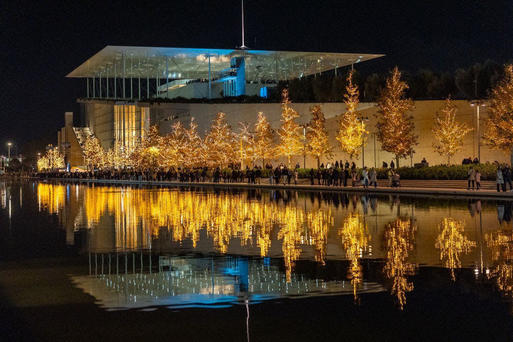

  May 29 – June 2, 2028 - Athens, Greece. 

  In honour of the 60th birthday of Ilias Kotsireas.

The workshop will bring together researchers and students interested in design theory, particularly its connections with Hadamard matrices and their applications. It will also welcome contributions from related areas, including coding theory, association schemes, sequences, finite geometry, difference sets, quantum information theory, theoretical physics, and computer security. Participants will have the opportunity to learn about recent developments, discuss new findings, assess the progress that has been made on classical problems, and explore possible directions for future research.

The workshop is the ninth in a series of conferences. The previous eight were held in Wollongong, Australia (1993); Seville, Spain (2007); Galway, Ireland (2009); Melbourne, Australia (2011); Lethbridge, Canada (2014); Budapest, Hungary (2017); Krakow, Poland (2022); and Seville, Spain (2025). The inaugural conference, held in 1993 and known as the “Hadamard Centenary” in recognition of Hadamard’s 1893 paper, was organised by Jennifer Seberry and colleagues.

<h2 id="us">Organising Committee</h2>

- [Santiago Barrera Acevedo](https://scholars.latrobe.edu.au/s2barreraace), La Trobe Unversity
- [Ilias Kotsireas](https://www.wlu.ca/academics/faculties/faculty-of-science/faculty-profiles/ilias-s-kotsireas/index.html), Wilfrid Laurier University

## Jump to

<a href="#schedule">Information</a>
&nbsp; | &nbsp;
<a href="#inv-sp">Invited Speakers</a>
&nbsp; | &nbsp;
<a href="#rego">Registration</a>
&nbsp; | &nbsp;
<a href="#dead">Deadlines</a>
&nbsp; | &nbsp;
<a href="#talks">Talks</a>
&nbsp; | &nbsp;
<a href="#them">Registered Participants</a>

<h2 id="schedule">Information</h2>

The conference will be held at the Stavros Niarchos Foundation Cultural Center (SNFCC), 364 Syggrou Avenue, 176 74 Kallithea, Athens, Greece. Further information about the venue is available on the <a href="https://www.snfcc.org/en/">SNFCC website</a>.

   

##Please click <a href="AAC09-BOA.pdf">here</a> to download the conference information booklet, which includes the abstracts and the schedule.

<h2 id="inv-sp">Invited Speakers</h2>

To be announced. 
 
<h2 id="rego">Registration</h2>

Not open yet. 

<h2 id="talks">Talk Schedule</h2>

Contributed talks are 20 minutes long, with an additional 5 minutes for questions and change of speaker.

<h2 id="them">Registered Participants</h2>

<table class="tg">
<thead>
  <tr>
    <th class="tg-0lax">Name</th>
    <th class="tg-0lax">Affiliation</th>
  </tr>
</thead>
<tbody>
  <tr>
    <td class="tg-7zrl">Santiago Barrera Acevedo</td>
    <td class="tg-7zrl">La Trobe University</td>
  </tr>
    <tr>
    <td class="tg-7zrl">Ilias Kotsireas</td>
    <td class="tg-7zrl">Wilfrid Laurier University</td>
  </tr>
</tbody>
</table>

<h2 id="diner">Conference Dinner</h2>

To be announced.

